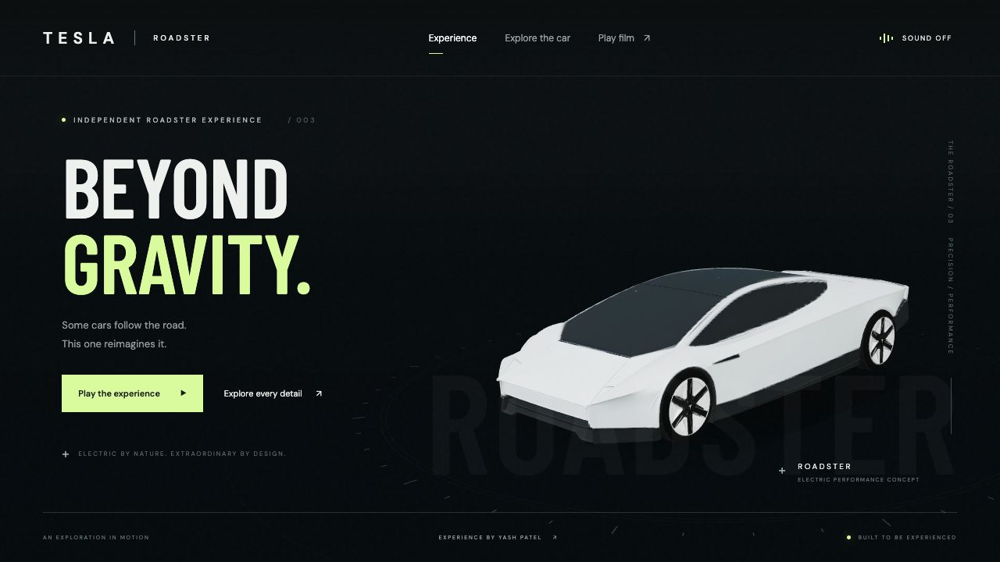

# Roadster — Beyond Gravity

A cinematic Roadster website by Yash Patel, using the actual vehicle supplied in **tesla-roadster-20.zip**. The same imported model appears on the landing page, in all close-up views, and throughout the stunt.

[Live website](https://yashvinodbhaipatel.github.io/tesla-roadster-cinematic/dist/) · [Update log](./CHANGELOG.md)



## Features

- The supplied GLB's geometry, UVs, body texture, aero wheels, canopy and rear details.
- Full-screen 3D showroom, exterior drag-to-orbit, front/canopy/rear/wheel/thruster close-ups.
- Four independently rotating wheel assemblies from the original model.
- A deterministic 720-frame / 24-second stunt: approach, inverted ramp climb, roll and landing.
- Pause, replay, frame stepping, timeline scrubbing and 0.25×/0.5×/1× playback.
- Original opt-in synthesized cinematic audio and stylized cold-gas effects.
- Download progress, responsive desktop and phone views, reduced-motion support, and load-error recovery.

## Asset scope

The ZIP's nested archive contains `26_10_23_23_57_30_974.glb`: 73 mesh/material nodes, one connected body shell and four wheel assemblies, with no authored animations. Its body is one connected mesh, not separately movable hood or door panels. It does not include a modeled cockpit. The interface therefore offers exterior close-ups; it does not substitute the previous generated car or pretend to open fused panels.

This update removes the old procedural vehicle and the Sketchfab iframe. Geometry positions, normals, UVs and triangle indices are preserved in the web asset. The source is centered and uniformly scaled at runtime. Wheel groups are pivoted around their actual axle centers.

Wheel texture maps are reduced to 256/512 pixels for web memory use; the main body maps stay at 2048 pixels. PNG payloads are recompressed and identical buffer data deduplicated. A gzip version is downloaded and decoded natively in supported browsers, with the standard GLB used by older browsers. Solid-black transmission maps do not require a transmission render pass.

The exterior asset was supplied by the project owner for integration. The archive contains no separate author/license document, so this repository does not grant an independent license to that model. Website authorship is separate from model authorship. Three.js 0.180.0 and the matching GLTFLoader/BufferGeometryUtils modules are bundled under the MIT license in `dist/assets/THREE-LICENSE.txt`.

This is an independent portfolio concept, not an official Tesla or SpaceX website. The stunt, effects and audio are artistic interpretations, not official footage or validated engineering.

## Run

Serve the folder over HTTP:

```sh
python3 -m http.server 4173 --directory dist
```

No build or package installation is required. All runtime assets are hosted with the website.

## GitHub Pages

The root `index.html` forwards to `dist/`. Deploy from the `main` branch and `/ (root)` directory.
